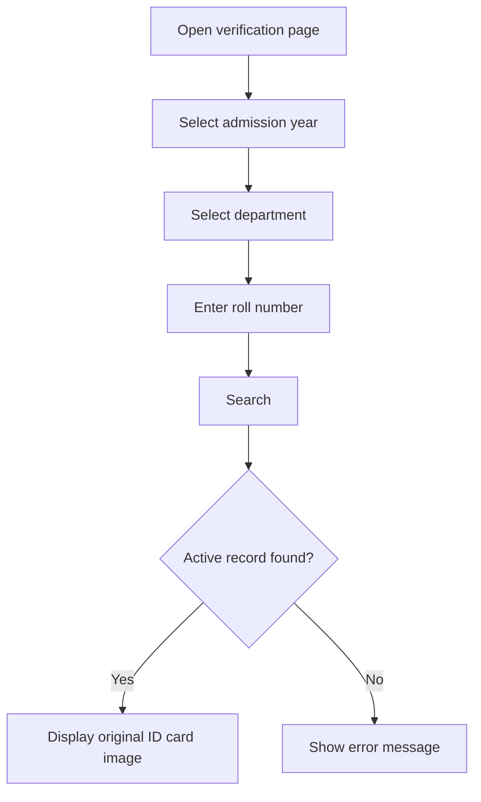

# Smart Student ID Verification System

A Django web application that lets authorized security staff verify a student's identity at a university entrance, even when the student has forgotten their physical ID card.

[](https://www.python.org/)
[](https://www.djangoproject.com/)
[](https://getbootstrap.com/)
[](https://www.sqlite.org/)
[]()

<!-- Add a screenshot or short GIF of the search page and a result here:

-->

## Table of Contents

- [Overview](#overview)
- [Features](#features)
- [How It Works](#how-it-works)
- [Tech Stack](#tech-stack)
- [Project Structure](#project-structure)
- [Getting Started](#getting-started)
- [Usage](#usage)
- [Data Model](#data-model)
- [Security and Privacy](#security-and-privacy)
- [Testing](#testing)
- [Roadmap](#roadmap)
- [Contributing](#contributing)
- [License](#license)

## Overview

Manual identity checks at campus gates are slow, and students who forget their ID cards cause further delays. This project replaces that process with a quick lookup: a guard selects the student's **admission year**, **department**, and enters the **roll number**. If an active matching record exists, the system displays the student's original uploaded ID card image for visual verification.

**Goal:** make campus entry verification faster, simpler, and more organized.

### Problem

- Delays at entry gates when students forget their ID cards
- Time-consuming manual verification
- No quick way for guards to access student identity records

### Solution

A centralized platform where records are managed by administrators and looked up by verification staff using three fields: admission year, department, and roll number.

## Features

**Verification**
- Look up a student by admission year, department, and roll number
- Display the original ID card image for a matching active record
- Clear "not found" message when no active match exists
- Search options (years, departments) are generated dynamically from existing records

**Record management (Django Admin)**
- Add, edit, and remove student records in one place
- Upload and manage ID card images
- Mark students as Active or Inactive
- Database-level uniqueness on admission year + department + roll number, preventing duplicates

**Interface**
- Clean, responsive layout built with Bootstrap 5
- Works on desktop and mobile browsers

## How It Works



## Tech Stack

| Layer | Technology |
|---|---|
| Language | Python 3.10+ |
| Backend | Django |
| Database | SQLite |
| Frontend | HTML5, CSS3, Bootstrap 5, JavaScript |
| Image handling | Pillow |

## Project Structure

```text
StudentVerification/
├── config/                  # Project settings and root URL configuration
│   ├── settings.py
│   ├── urls.py
│   ├── asgi.py
│   └── wsgi.py
├── students/                # Main application
│   ├── migrations/
│   ├── templates/students/
│   │   └── search.html      # Verification page
│   ├── admin.py             # Admin configuration
│   ├── models.py            # Student model
│   ├── views.py             # Search / verification logic
│   ├── urls.py
│   └── tests.py
├── media/student_cards/     # Uploaded ID card images (not tracked in Git)
├── manage.py
└── README.md
```

> This shows the main files only. Your local copy may contain more.

## Getting Started

### Prerequisites

- Python 3.10 or newer
- `pip` and `venv`
- Git

### Installation

```bash
# 1. Clone the repository
git clone https://github.com/YOUR-USERNAME/YOUR-REPOSITORY.git
cd YOUR-REPOSITORY

# 2. Create and activate a virtual environment
python -m venv venv

# Windows
venv\Scripts\activate
# Linux / macOS
source venv/bin/activate

# 3. Install dependencies
pip install django pillow

# 4. Set up the database
python manage.py migrate

# 5. Create an administrator account
python manage.py createsuperuser

# 6. Start the development server
python manage.py runserver
```

Then open:

| Page | URL |
|---|---|
| Student verification | http://127.0.0.1:8000/ |
| Admin panel | http://127.0.0.1:8000/admin/ |

> **Tip:** Run `pip freeze > requirements.txt` and commit the file so others can install with `pip install -r requirements.txt`.

## Usage

### Administrators

1. Log in to the Django Admin panel.
2. Add a student: name, admission year, department, and roll number.
3. Upload the original ID card image.
4. Set the status to **Active** or **Inactive**.

### Verification staff

1. Open the verification page.
2. Select the admission year and department.
3. Enter the roll number and click **Search**.
4. Compare the displayed ID card image with the person at the gate.

Inactive or non-existent records return a "not found" result.

## Data Model

Each student record contains the following (conceptual overview; see `students/models.py` for exact field names):

| Field | Description |
|---|---|
| Admission year | Batch the student belongs to |
| Department | Student's department |
| Roll number | Identifier within the batch and department |
| ID card image | Uploaded image of the original university ID |
| Status | Active or Inactive |

A **unique constraint** on *(admission year, department, roll number)* guarantees one record per student.

## Security and Privacy

Student ID cards contain personal information. Please follow these guidelines.

**For development and public repositories**
- Use **fictional data** only. Never commit real student records or ID images.
- Keep `db.sqlite3`, `media/`, and any secrets out of version control. Suggested `.gitignore` entries:

  ```gitignore
  venv/
  db.sqlite3
  media/
  .env
  __pycache__/
  *.pyc
  ```

**Before any real-world deployment**
- [ ] Require authentication for the verification page, not only the admin panel
- [ ] Enforce role-based permissions (administrators vs. security staff)
- [ ] Serve media files through protected access, not public URLs
- [ ] Set `DEBUG = False` and restrict `ALLOWED_HOSTS`
- [ ] Load `SECRET_KEY` from an environment variable
- [ ] Serve the application over HTTPS
- [ ] Replace SQLite with a production-grade database if load requires it

## Testing

```bash
python manage.py test
```

## Roadmap

- [ ] QR-code-based verification
- [ ] Mobile-friendly interface for guards
- [ ] Role-based access control for administrators and security staff
- [ ] Verification activity logs (who checked what, and when)
- [ ] Advanced search and filtering
- [ ] Deployment on a university-hosted server

## Contributing

This is an academic OOP project. Suggestions and constructive feedback are welcome. Feel free to open an issue or submit a pull request.

## License

Provided for educational and academic purposes. A formal open-source license (e.g., MIT) can be added if the project is released for public reuse.

---

<p align="center">
  <b>Smart Student ID Verification System</b><br>
  Faster, simpler campus identity verification.
</p>
