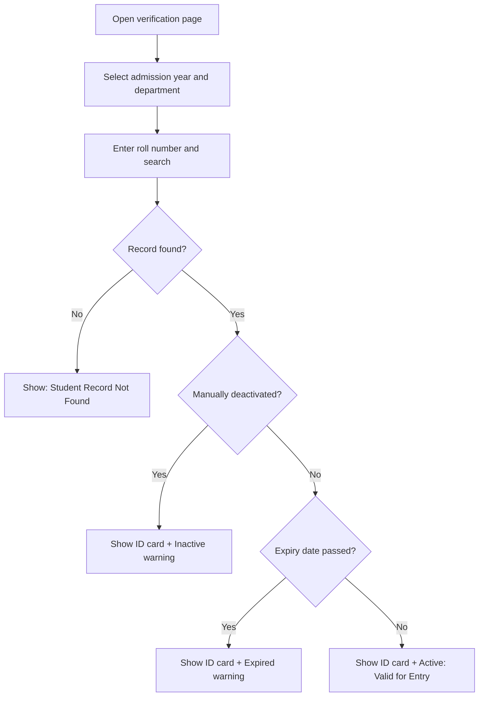

# Smart Student ID Verification System

A Django web application that lets authorized security staff verify a student's identity at a university entrance by looking up their record, viewing the original ID card image, and checking whether the card is still valid.


<!-- Add a screenshot or short GIF of the search page and each result state:

-->

## Table of Contents

- [Overview](#overview)
- [Features](#features)
- [Verification Rules](#verification-rules)
- [How It Works](#how-it-works)
- [Tech Stack](#tech-stack)
- [Project Structure](#project-structure)
- [Getting Started](#getting-started)
- [Usage](#usage)
- [Data Model](#data-model)
- [Security and Privacy](#security-and-privacy)
- [Testing](#testing)
- [Roadmap](#roadmap)
- [Author](#author)
- [License](#license)

## Overview

Students sometimes arrive at campus without their physical ID cards, which slows entry and adds work for security staff. This project replaces slow manual checks with a quick digital lookup.

A guard selects the student's **admission year** and **department**, then enters the **roll number**. The system finds the matching record, shows the original uploaded ID card image, and reports whether the card is currently valid, expired, or deactivated.

**Goal:** make university identity verification faster, more reliable, and better organized.

### The problem

- Students forget or misplace their ID cards, causing delays at the gate.
- Manual verification is slow and hard to do consistently.
- Student identity records are inefficient to manage and access by hand.
- Expired cards can be accepted by mistake when validity isn't tracked.

### The solution

A centralized platform where administrators manage student records and card expiry dates, and verification staff look up students using three fields: admission year, department, and roll number.

## Features

**Student verification**
- Search by admission year, department, and roll number
- Display the original uploaded ID card image and student details
- Clear, color-coded result for every outcome: valid, expired, inactive, or not found
- Search options (years and departments) generated dynamically from existing records

**Record management (Django Admin)**
- Add, edit, and remove student records in one place
- Upload and replace ID card images
- Set card expiry dates and Active/Inactive status
- Search and filter records in the admin interface
- Unique constraint on batch year + department + roll number prevents duplicates

**ID card expiry management**
- Expiry date is checked at verification time, so an expired card is never treated as valid
- Cards expiring today remain valid through the end of that day
- Manual deactivation always overrides the expiry date

**Interface**
- Clean, responsive Bootstrap 5 layout for desktop and mobile
- Clear success and error messages
- Visual status indicators and an ID card image preview

## Verification Rules

Each search is evaluated in the following order, and the first matching rule determines the result.

| # | Condition | Result |
|---|---|---|
| 1 | No record matches the search | **Student Record Not Found** |
| 2 | Student was manually deactivated | **Inactive: Not Valid for Entry** |
| 3 | Card expiry date has passed | **Inactive: Expired Card** |
| 4 | Card expires today | **Active: Valid for Today** |
| 5 | Card expiry date is in the future | **Active: Valid for Entry** |

For matched records (rules 2 to 5), the original ID card image is displayed so the guard can compare it with the person at the gate. Expired and inactive cards always show a warning and must never be accepted for entry.

**Status values**

- **Active:** the card is currently valid and the student is eligible for entry.
- **Inactive:** the card has expired or an administrator has deactivated the student.

## How It Works



**Registration (administrator):** log in to Django Admin, create the student record, select the admission year and department, enter the card expiry date, upload the original ID card image, and save.

**Verification (security staff):** open the verification page, select year and department, enter the roll number, search, then review the ID card image and status.

## Tech Stack

| Layer | Technology |
|---|---|
| Language | Python 3.10+ |
| Backend | Django |
| Database | SQLite |
| Frontend | HTML5, CSS3, Bootstrap 5, JavaScript |
| Image handling | Pillow |
| Version control | Git and GitHub |

## Project Structure

```text
StudentVerification/
├── config/                  # Project settings and root URL configuration
│   ├── settings.py
│   ├── urls.py
│   ├── asgi.py
│   └── wsgi.py
├── students/                # Main application
│   ├── migrations/
│   ├── templates/students/
│   │   └── search.html      # Verification page
│   ├── admin.py             # Admin configuration
│   ├── models.py            # Student model
│   ├── views.py             # Search and verification logic
│   ├── urls.py
│   └── tests.py
├── media/student_cards/     # Uploaded ID card images (not tracked in Git)
├── manage.py
├── README.md
└── .gitignore
```

> This shows the main files only. Your local copy may contain more.

## Getting Started

### Prerequisites

- Python 3.10 or newer
- `pip` and `venv`
- Git

### Installation

```bash
# 1. Clone the repository into a folder named StudentVerification
git clone https://github.com/husnaincodes/-Smart-Student-ID-Verification-System.git StudentVerification
cd StudentVerification

# 2. Create and activate a virtual environment
python -m venv venv

# Windows
venv\Scripts\activate
# Linux / macOS
source venv/bin/activate

# 3. Install dependencies
pip install django pillow

# 4. Apply database migrations
python manage.py migrate

# 5. Create an administrator account
python manage.py createsuperuser

# 6. Start the development server
python manage.py runserver
```

Then open:

| Page | URL |
|---|---|
| Student verification | http://127.0.0.1:8000/ |
| Admin panel | http://127.0.0.1:8000/admin/ |

> **Notes**
> - Run `python manage.py makemigrations` only if you change the models.
> - Run `pip freeze > requirements.txt` and commit the file so others can install with `pip install -r requirements.txt`.

## Usage

### Administrators

1. Open the Django Admin panel and log in.
2. Go to the **Students** section and add a new student.
3. Enter the student's name, roll number, admission year, and department.
4. Upload the original ID card image.
5. Enter the card expiry date.
6. Set the status and save.

### Verification staff

1. Open the verification page.
2. Select the admission year and department.
3. Enter the roll number and click **Search**.
4. Review the displayed ID card image and verification status.

Security staff should only be given permission to verify students, never to modify records.

## Data Model

The main model is `Student`.

| Field | Description |
|---|---|
| `student_name` | Full name of the student |
| `roll_number` | Roll number, unique within a batch and department |
| `batch_year` | Admission year |
| `department` | Academic department |
| `student_card` | Uploaded original ID card image |
| `status` | Active or Inactive |
| `card_expiry_date` | Expiry date of the ID card |

**Data integrity**

- A unique constraint on (`batch_year`, `department`, `roll_number`) prevents duplicate identities.
- ID card images are stored using Django media storage.
- All data access goes through the Django ORM.

## Security and Privacy

Student ID cards contain personal information, so handle them carefully.

**For development and public repositories**

- Use **fictional data** only. Never commit real student records or ID card images.
- Keep `db.sqlite3`, `media/`, credentials, and secrets out of version control. Recommended `.gitignore` entries:

  ```gitignore
  venv/
  db.sqlite3
  media/
  .env
  __pycache__/
  *.pyc
  ```

**Before any real-world deployment**

- [ ] Require authentication on the verification page, not only the admin panel
- [ ] Enforce role-based permissions (administrators vs. security staff)
- [ ] Serve ID card images through an authorized access mechanism; Django's development media serving is **not** secure enough for production
- [ ] Set `DEBUG = False` and restrict `ALLOWED_HOSTS`
- [ ] Load `SECRET_KEY` from an environment variable
- [ ] Serve the application over HTTPS
- [ ] Use a production-grade database if load requires it

## Testing

Run the automated tests:

```bash
python manage.py test
```

Manual test scenarios to complete before deployment:

| Test case | Expected result |
|---|---|
| Search an Active student with a valid card | Details and ID card shown with Active status |
| Search a manually deactivated student | ID card shown with Inactive warning |
| Search a student with an expired card | ID card shown with Expired warning |
| Search a non-existent student | Student Record Not Found |
| Search with an incorrect roll number | No matching record |
| Change a card's expiry date | Result reflects the updated validity |
| Upload a valid image | Image uploaded successfully |
| Enter a duplicate student identity | Duplicate record rejected |

## Roadmap

- [ ] QR-code-based student verification
- [ ] Role-based access control for university staff
- [ ] Verification activity logs
- [ ] Advanced search and filtering
- [ ] Email notifications before ID card expiry
- [ ] Mobile-friendly verification interface
- [ ] Dashboard with student and verification statistics
- [ ] Deployment on a university server

## Author

**Husnain Tayab**
GitHub: [@husnaincodes](https://github.com/husnaincodes)
Repository: [Smart Student ID Verification System](https://github.com/husnaincodes/-Smart-Student-ID-Verification-System)

## License

Developed for educational and academic purposes as part of an Object-Oriented Programming project. A formal open-source license (for example, MIT) can be added if the project is released for public reuse.

---

<p align="center">
  <b>Smart Student ID Verification System</b><br>
  <i>Simplifying student identity verification through technology.</i>
</p>
